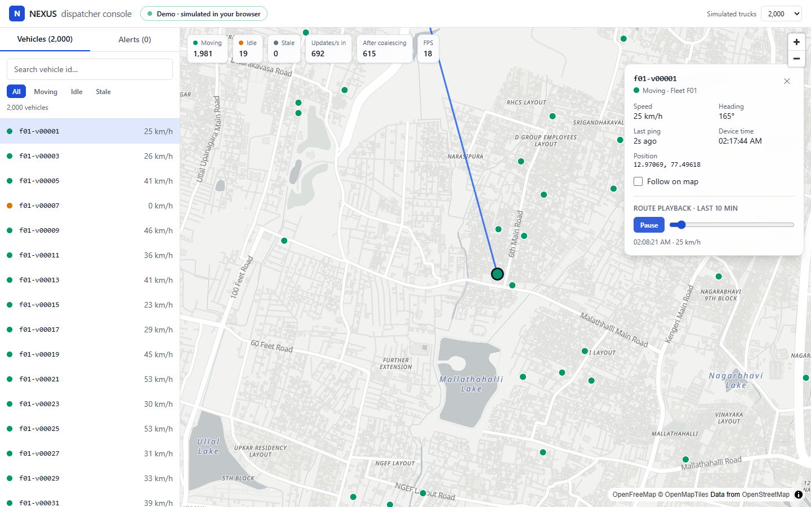

# NEXUS: real-time fleet tracking

NEXUS ingests signed GPS telemetry from thousands of trucks, streams it through Kafka into TimescaleDB, and pushes live
positions to a WebGL dispatcher console. It stays correct through crashes, redeliveries, bad data and outages.

**Live demo:** https://devanshubh.github.io/Nexus/ · the hosted console simulates a fleet in your browser; run the stack below for live data.



## What it guarantees, and the evidence

| Guarantee | How | Evidence |
|---|---|---|
| **Zero lost pings** | Ingest answers only after Kafka acknowledges (`acks=all`, idempotent producer); the writer commits offsets only after Postgres commits | Chaos run (kill -9 writer, Postgres down 40 s, Kafka down 40 s): **21,311 acknowledged = 21,311 stored** ([incidents](docs/notebooks/incidents.md)) |
| **Zero duplicate rows** | COPY into a reused temp staging table → `INSERT … ON CONFLICT DO NOTHING` on `(vehicle_id, event_ts, event_id)` | Integration test crashes the writer between DB commit and offset commit; after restart rows = distinct events |
| **Bad rows never block good ones** | SQLState classes: data errors → bisect and park in the DLQ; outages → pause, `seek()` back, retry whole batch | 500 rows with 3 bad → 497 stored, exactly 3 in the DLQ; a DB outage parks nothing |
| **Trucks never move backwards** | One Redis Lua script compares event time, writes, updates the GEO index and publishes, atomically; the browser guards again | Replay of hour-old pings leaves positions unchanged (test); the console counts rejected late pings |
| **A slow browser can't hurt others** | Netty write-buffer watermarks; per-client buffer of newest position per truck, flushed every 250 ms | Unit test: a client that never reads stays at a fixed buffer size |
| **Tenant isolation** | Per-device HMAC keys; dispatcher JWTs carry fleets, checked on every query and subscription | Tests for tampered body, wrong fleet, replayed nonce, revoked key, `alg=none` |

Measured on one laptop (i5-14600KF, Docker Desktop): **5,000 trucks → 1,642 events/s stored, event age p99 ≤ 1.8 s,
zero consumer lag.** The first resource to saturate is the ingest API (~1 core); everything else idles.
Details and method in [docs/benchmarks.md](docs/benchmarks.md).

## Architecture

```
 devices ──signed HTTPS──▶ ingest API ──acks=all──▶ Kafka (12 partitions, key = vehicleId)
                                                        │
                                                        ▼
                         TimescaleDB ◀──COPY + ON CONFLICT── writer ──Lua guard──▶ Redis (GEO + Pub/Sub)
                              │                            │ bisect                    │
                              ▼                            ▼                           ▼
                          query API                  nexus.gps.dlq           Netty WebSocket gateway
                              └──────────── snapshot + history ──▶ console ◀── batched live positions
```

| Module | What it is |
|---|---|
| [`nexus-common`](nexus-common) | Ping model, validation, HMAC device signatures, strict HS256 JWT |
| [`nexus-ingest`](nexus-ingest) | Spring Boot HTTP edge: auth, replay protection, validation, per-device rate limit, publish-then-answer |
| [`nexus-writer`](nexus-writer) | Plain `kafka-clients` consumer loop, COPY writer, error classification, bisection, DLQ, pause/seek backpressure, Redis live state; Flyway schema; DLQ replay CLI |
| [`nexus-query`](nexus-query) | Fleet snapshot (Redis `GEOSEARCH BYBOX`) and route history (raw or 1-minute continuous aggregate) |
| [`nexus-gateway`](nexus-gateway) | Netty WebSocket server: auth, per-fleet subscriptions, coalescing, batching, heartbeats |
| [`nexus-simulator`](nexus-simulator) | Signed traffic for N trucks with bursts, bad data, clock skew, hot devices, offline backlogs |
| [`web`](web) | Next.js 16 dispatcher console: MapLibre GL, Web Worker data path, demo and live modes |

The design doc ([docs/design.md](docs/design.md)) covers requirements, estimates, failure modes and trade-offs.
Decisions are recorded in [docs/adr](docs/adr), alerts have [runbooks](docs/runbooks), and there is a
[threat model](docs/threat-model.md).

## Run it

Requirements: Docker, plus JDK 25 and Node 22 for development.

```sh
docker compose up -d --build        # Kafka (KRaft), TimescaleDB, Redis, 4 services, 200 simulated trucks
docker compose --profile observability up -d   # + Prometheus :9090 (alerts) and Grafana :3001 (dashboard)

# The console against the live stack
cd web && npm ci
NEXT_PUBLIC_QUERY_URL=http://localhost:8081 NEXT_PUBLIC_GATEWAY_URL=ws://localhost:8090/ws npm run dev
# open http://localhost:3000/console/?mode=live
```

More trucks: `SIM_TRUCKS=1000 docker compose up -d simulator`. Simulator flags (hot devices, bursts, offline share,
malformed rate) are documented in [`Simulator.java`](nexus-simulator/src/main/java/dev/nexus/simulator/Simulator.java).

Try the failure modes yourself:

```sh
docker kill -s KILL nexusbuild-writer-1 && docker compose start writer   # redelivery, no duplicates
docker compose stop timescaledb; sleep 40; docker compose start timescaledb   # writer pauses, rewinds, resumes
docker compose stop kafka; sleep 40; docker compose start kafka          # ingest 503s, devices buffer and retry
docker compose exec timescaledb psql -U nexus -d nexus -c \
  "select count(*), count(distinct (vehicle_id, event_ts, event_id)) from gps_events"
curl -s localhost:8080/actuator/prometheus | grep nexus_ingest_accepted_total   # equals the row count once drained
```

## Tests

```sh
./mvnw verify                          # 59 JVM tests; integration tests start Kafka, TimescaleDB and Redis via Testcontainers
cd web && npm test && npm run build    # 8 front-end tests, typecheck, static export
```

CI runs both on every pull request and publishes a multi-arch (amd64 + arm64) backend image to GHCR from `main`.

## Deploying the console (free)

The console is a static export. On Vercel: import the repository, set **Root Directory** to `web`, and deploy; the
framework is detected and `web/vercel.json` adds CSP, HSTS and caching headers. Without backend URLs it runs in demo
mode; set `NEXT_PUBLIC_QUERY_URL` and `NEXT_PUBLIC_GATEWAY_URL` to point it at a running stack.

## Status

Built: the core track (ingest, exactly-once storage, live fan-out, security, observability, chaos runs, benchmarks)
and the dispatcher console. Next: profile and scale out ingest; partition and batch-size sweeps; Protobuf device
protocol with sequence numbers; H3 viewport subscriptions; Ed25519 device keys; a streaming replica with a failover
drill; tiered storage; a 50,000-truck run in a planned cloud window ([design §8](docs/design.md#8-trade-offs-and-evolution)).
